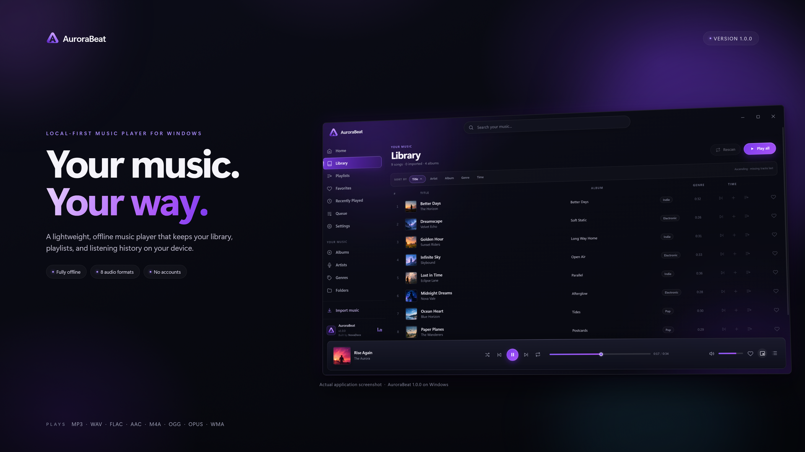

# NovaDevx — website

The official website for **NovaDevx**, an independent software studio building
focused desktop tools. Its first product is **AuroraBeat 1.0.0**, a local-first
music player for Windows.

**Live site → https://novadevx2.github.io/novadevx/**



## Highlights

- Plain **HTML, CSS, and vanilla JavaScript** — no framework, package manager,
  build step, external font, or runtime dependency.
- Every path is relative, so the same files work from your filesystem, a local
  server, or a GitHub Pages subpath without configuration.
- Ships as a static artifact deployed by GitHub Actions.

## Pages

| Page             | What's there                                                                                                     |
| ---------------- | ---------------------------------------------------------------------------------------------------------------- |
| `index.html`     | Homepage: the studio, AuroraBeat as featured work, application showcase, studio principles, and a downloads call to action |
| `downloads.html` | AuroraBeat 1.0.0: release details, supported formats, download panel, and five feature previews                    |

Both pages share `css/style.css` and `js/main.js`.

## AuroraBeat 1.0.0

A local-first music player for Windows x64. It reads the folders you choose,
keeps the index on your machine, and never talks to a server.

- Local library indexing with tags, artwork, years, and durations
- Eight formats: MP3, WAV, FLAC, AAC, M4A, OGG, OPUS, WMA
- Seekable playback with shuffle, repeat, volume, and a persistent queue
- Playlists, favorites, search, sorting, rescanning, and metadata edits
- A 460 × 188 mini player with artwork, seek, transport, and window controls
- Dark, light, and system themes with six accents and two densities
- Tray controls and global media keys
- Installer and portable builds, with WebView2 bundled offline

No account, no cloud library, no background network calls.

## Run it locally

There is nothing to install and nothing to build. Opening `index.html` directly
works, because every path is relative.

If you'd rather use a local server that mirrors how GitHub Pages serves the site:

```bash
python -m http.server 8000
```

Then open <http://localhost:8000/> and <http://localhost:8000/downloads.html>.

## Project layout

```text
website/
├── index.html                  # homepage
├── downloads.html              # AuroraBeat release + download
├── Novadev.png                 # NovaDevx logo
├── css/style.css               # all styling
├── js/main.js                  # nav, scroll reveals, small behaviour
├── assets/                     # brand SVGs
├── promotional-assets/         # AuroraBeat artwork used across both pages
│   ├── README.md               # asset catalog, sources, regeneration notes
│   ├── hero-main-*.png         # hero banner (1920 and 3840 wide)
│   ├── app-showcase-*.png      # application showcase
│   ├── download-page-*.png     # downloads page presentation
│   ├── feature-*.png           # five feature previews (1280 and 2560 wide)
│   ├── product-card-*.png      # square product cards (800 and 1600)
│   ├── app-icon-*.png          # icon and icon presentations
│   ├── _build/                 # capture + render scripts that generate the artwork
│   └── screenshots/            # real captures of the packaged app
└── .github/workflows/deploy.yml
```

Only the files the pages reference are published. The 4K and 2× source sizes stay
in the repository, and `_build/` plus `screenshots/` never reach the deployed
artifact. The full artwork catalog, capture sources, and design system are
documented in [`promotional-assets/README.md`](promotional-assets/README.md).

## Deploying

The site is published to GitHub Pages by `.github/workflows/deploy.yml`, which
runs on every push to `main` and can be triggered by hand from the **Actions**
tab.

The workflow checks out the repository, copies the pages, logo, CSS, JavaScript,
and the referenced artwork into `_site`, then publishes that directory. Because
it copies from an explicit list rather than the whole repository, a newly added
top-level folder needs a matching `cp` line to go live.

To stand up a copy of this site:

1. Push the repository to GitHub.
2. Go to **Settings → Pages** and set **Source** to **GitHub Actions**.
3. Push to `main`, or run the **Deploy static site to GitHub Pages** workflow.

The site appears at `https://<user>.github.io/<repo>/` for a project repository,
at `https://<user>.github.io/` for a `<user>.github.io` repository, or on a
custom domain configured in **Settings → Pages**. Keep `.nojekyll` in place so
Pages serves the files without Jekyll processing.

## Accessibility and behaviour

- Semantic landmarks, a skip link, keyboard-operable navigation, and visible
  focus styles.
- The mobile menu handles `Escape`, focus return, a focus loop, outside clicks,
  and closes itself once the viewport reaches desktop width.
- Scroll reveals use `IntersectionObserver` and are disabled under
  `prefers-reduced-motion`. Without JavaScript, all content stays visible.
- Images carry descriptive alt text drawn from the real screenshots; purely
  decorative icons use empty alt text.
- The layout responds at roughly 1080, 980, 900, 820, 640, and 400 pixels, with a
  single-column reading flow on phones.

## License

Released under the [GNU Affero General Public License v3.0](LICENSE).

## Contact

NovaDevx — [novadevx@proton.me](mailto:novadevx@proton.me)
