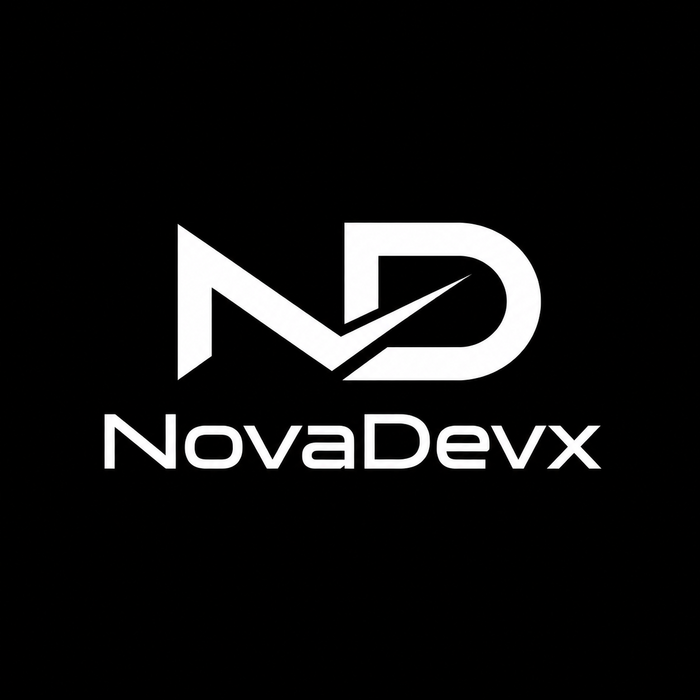

# NovaDevx

<p>
  
</p>

**Independent software studio.** NovaDevx designs and builds focused desktop
tools — software with a clear purpose, a considered interface, and none of the
clutter that gets in the way.

**The site → https://novadevx2.github.io/novadevx/**

This repository is the studio's home on the web: a small, hand-made site that
introduces NovaDevx, shows the software it builds, and hosts the release details
and downloads for its products.

## The studio

NovaDevx is small on purpose. Each project is designed, engineered, and finished
in-house, from the first sketch to the release build, against one standard:

- **Clarity over clutter.** Every element earns its place. If it doesn't help the
  person using it, it doesn't belong.
- **Details are the design.** Spacing, motion, wording, and edge cases matter as
  much as the feature list.
- **Local-first by default.** Software should respect your machine. Your files and
  history stay where they belong — on your device.

## What's here

| Page             | Contents                                                                                                         |
| ---------------- | ---------------------------------------------------------------------------------------------------------------- |
| `index.html`     | Homepage: the studio, featured work, an application showcase, the design principles, and a path to downloads      |
| `downloads.html` | Release details, supported formats, the download panel, and feature previews                                      |

Both pages share `css/style.css` and `js/main.js`.

## Software

**AuroraBeat 1.0.0** — the studio's first release. A local-first music player for
Windows x64 that reads the folders you choose, keeps its index on your machine,
and never talks to a server.

- Library indexing with tags, artwork, years, and durations
- Eight formats: MP3, WAV, FLAC, AAC, M4A, OGG, OPUS, WMA
- Playlists, favorites, search, sorting, and a persistent queue
- A 460 × 188 mini player, dark and light themes, tray controls, and media keys
- No account, no cloud library, no background network calls

Release details and the download live on the
[downloads page](https://novadevx2.github.io/novadevx/downloads.html).

The artwork across the site is genuine captures of the packaged application;
[`promotional-assets/README.md`](promotional-assets/README.md) documents every
asset, its source, and how the set is generated.

## How the site is built

Plain **HTML, CSS, and vanilla JavaScript**. No framework, package manager, build
step, external font, or runtime dependency — which means the whole site is small,
fast, and readable as-is.

Every path is relative, so the files work identically from a folder on disk or
from a hosted subpath. The pages are responsive down to phone widths, keyboard
navigable, and honour `prefers-reduced-motion`.

## Layout

```text
website/
├── index.html                  # homepage
├── downloads.html              # release details and download
├── Novadev.png                 # logo
├── css/style.css               # all styling
├── js/main.js                  # navigation and small behaviour
├── assets/                     # brand SVGs
└── promotional-assets/         # product artwork used across both pages
    ├── README.md               # catalog, sources, regeneration notes
    ├── _build/                 # capture and render scripts
    └── screenshots/            # real captures of the packaged app
```

## Local preview

Nothing to install. Opening `index.html` works, or for a local server:

```bash
python -m http.server 8000
```

## License

Released under the [GNU Affero General Public License v3.0](LICENSE).

## Contact

NovaDevx — [novadevx@proton.me](mailto:novadevx@proton.me)
